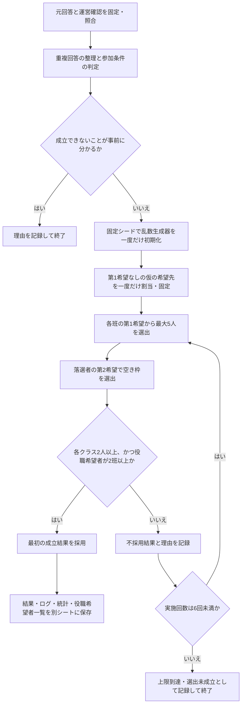

# 卒業を祝う会 実行委員の抽選方法

生徒の希望をできる限り尊重しながら、学年全体の運営と各クラスへの連絡体制を確保するための選出方法を説明する。公平性の根拠は、全員に共通するルールを抽選前に固定し、運営側の好みによる選び直しを防ぎ、過程を後から検証できることにある。

**実装状況：本書は合意済みの抽選仕様である。現在のコードはデプロイ確認用で、抽選処理はまだ実装されていない。** 以下は実施予定の方式を説明しており、抽選を実行済みという意味ではない。

## 募集人数と、20人から25人に増員した理由

対象は、企画班、司会進行班、音響照明班、会場演出班、有志団体統括班の5班。当初の各班4人・合計20人から、**各班最大5人・合計最大25人**へ増員する。

主な理由は、委員長・副委員長の業務負担を考慮するためである。委員長・副委員長も、当初割り当てられた班の仕事を兼務する。ただし、活動の軸足は実行委員会全体の運営に置くため、所属班の仕事に充てられる時間や労力が少なくなることを想定している。

そこで各班を1人ずつ増員し、役職に1人を送り出した場合でも、班の活動を中心的に担う4人を確保できる体制を目指す。委員長と副委員長は異なる班から選ぶ方針とする。

また、今年度は重複回答を整理した後の応募者が69人と、例年より多かった。増員には、運営体制を補強するとともに、できるだけ多くの生徒に役割を担ってもらい、当選の機会を広げる利点もある。69人は参加条件による除外前の人数である。

希望者が足りない班は欠員とするため、必ず25人を選出する方式ではない。「役職に1人を送り出しても4人を確保する」は、5人そろった班における定員設定の狙いであり、欠員のある班について4人を保証するものではない。

## 抽選対象者の確認

### 1人を複数の応募として扱わない

同じ「クラス＋出席番号」の回答は同一人物として照合し、**入力として固定した回答の行順で、最後に出てくる回答**を採用する。先に回答した人を抽選で優先することはなく、タイムスタンプの大小で採用する回答を選び直すこともしない。

出席番号の全角・半角、先頭のゼロ、末尾の「番」は、照合時に同一視する。この処理は読み取ったデータ上で行い、元の回答シートを修正・削除・並べ替えない。

### 運営側の確認は別シートで管理する

フォーム回答と、運営側が確認した事情を区別するため、後者は「運営確認」シートの表「運営追記」に記録する。**削除済みの旧N列は参照しない。**

運営確認は、採用した回答に結び付けるだけでなく、クラスと正規化した出席番号で本人に照合する。回答が重複していても、運営確認の記録が失われないようにする。

次の条件を、全員に共通して適用する。

| 判定項目 | 扱い |
| --- | --- |
| 「重複不可委員就任済み」に記載がある | 抽選対象から除外する |
| K列のオリエンテーションに「参加できません」と回答 | その項目の公欠承認がなければ除外する |
| L列の準備・打ち合わせに「参加できません」と回答 | その項目の公欠承認がなければ除外する |
| L列の「予定によっては参加できない日があります」 | この回答を理由に除外しない |
| L列の「参加が難しい可能性があります」 | この回答を理由に除外しない |
| 運営確認で、その参加項目について公欠承認済み | 該当する参加条件を満たすものとして扱う |

L列は「参加できません」以外の回答を、その回答だけを理由に除外しない。

### 重複不可委員の範囲と、抽選対象から除く理由

重複不可委員とは、卒業を祝う会と同時期に活動する、**合唱コンクールに関する委員と、卒業アルバムに関する委員**を指す。これらの委員と卒業を祝う会の実行委員との兼務は、募集時に禁止と明記し、就任済みの生徒は本委員に応募しないよう案内している。

この条件には、次の3つの理由がある。

1. **なるべく多くの生徒が、卒業を象徴する行事の運営に関われるようにするため。** 卒業を祝う会、合唱コンクール、卒業アルバムという3つの取組を、できるだけ多くの生徒が役割を担って運営することを基本方針としている。
2. **同時期の大きな行事を兼務することによる、実務上の支障を避けるため。** 準備や打ち合わせの日程が重なり、ダブルブッキングなどが起きやすくなることを考慮している。
3. **募集条件を守って応募を控えた生徒との公平性を保つため。** 兼務禁止の案内に従い、本委員への応募を辞退した生徒もいると考えられる。応募後に兼務を例外的に認めて抽選対象に含めると、事前のルールを守った生徒との間で扱いに差が生じる。

そのため、該当する委員に就任済みの生徒は、事前に示した応募条件に基づいて抽選前に対象外とし、**抽選対象人数（母数）に含めない。** 「運営確認」シートの表「運営追記」に記録した就任状況を用いて、全員に同じ条件を適用する。

### 公欠承認の適用範囲

公欠承認はK・Lの項目ごとに適用する。Kの公欠が認められても、Lで参加できず、その項目の承認もなければ除外する。公欠承認によって、重複不可委員の除外を取り消すことはない。確認理由は「運営追記」のメモに残す。

## 希望に基づく選出の順序

### 第1希望による選出

まず、全班について第1希望の応募者から選出する。

- 対象者が5人以下の場合は全員を選出する。
- 対象者が5人を超える場合は、その班の応募者から抽選で5人を選出する。

第2希望の内容を理由として、第1希望の抽選で優先したり、不利に扱ったりしない。同じ班・同じ希望順位の抽選に、個人ごとの加点や優先順位を設けない。

### 第2希望による選出

全班の第1希望による選出が終わってから、**第1希望で落選した人だけ**を対象に、第2希望の班の空き枠で選出する。

- 希望者が空き枠以下の場合は全員を選出する。
- 希望者が空き枠を超える場合は、希望者から空き枠の人数を抽選する。
- 第1希望ですでに選ばれた人は、第2希望の抽選に参加しない。1人が複数の班に選ばれることはない。
- 第2希望が「特になし」の人を、別の班へ自動で回すことはしない。
- それでも埋まらない枠は欠員とする。第3希望の推測や、希望していない班への追加の割当は行わない。

### 「第1希望なし」の扱い

第1希望が「特に希望なし」の人には、選出に先立ち、5班から等しい確率で1班を仮の第1希望として割り当てる。その後は、その班を第1希望とした他の応募者と同じ手順で選出する。

この割当は固定シードを用いて**最初に一度だけ**行う。再抽選でも変更しない。仮の割当先と元の回答は区別して記録し、元の回答は書き換えない。

不足班への優先配置は行わない。「希望なし」と回答することで、必ず当選できる仕組みにはしないためである。ただし、班ごとの応募倍率が異なる以上、ランダムに割り当てられた班によって当選しやすさは変わる。「希望なし」と特定の班を希望した人の当選確率が、常に同じになるわけではない。

## 抽選結果の採用条件と再抽選

第1希望・第2希望による選出を終えた時点で、次の**両方**を確認する。

1. 各クラスから少なくとも2人が当選している。
2. 当選した委員長・副委員長希望者が、少なくとも2つの班に所属している。

各クラスの最低人数は、クラスへの連絡体制を確保するために設ける。一方、クラスごとに応募者数が異なるため、各クラスから一律に5人ずつ選ぶ方式は採用しない。

役職希望者の所属班に関する条件は、異なる班から委員長・副委員長を選ぶ話し合いができる状態を確保するために設ける。役職希望者が0人の場合、1人だけの場合、全員が同じ班の場合も条件未達となる。

条件未達の場合は、一部の当選者を手作業で入れ替えず、**第1希望・第2希望による委員選出全体**をやり直す。「第1希望なし」の仮の割当は維持する。2つの条件は、毎回、同じ当選結果に対して同時に確認する。

**両方の条件を初めて満たした結果を採用し、そこで抽選を終了する。** さらに好ましい結果を探して続けたり、複数の成立結果から運営側が選んだりはしない。

### 回数の上限と、成立しない場合

上限は、**初回1回＋再抽選最大5回、合計最大6回**とする。

- 候補者数や希望先などから、条件を満たせないことが事前に分かる場合は、開始せず理由を記録する。
- 事前確認を通過しても、条件を満たす結果が得られるとは限らない。
- 第6回までに条件を満たさなければ、当選結果を採用せず「試行回数の上限により選出未成立」として終了する。
- 上限到達は「その試行範囲では結果を得られなかった」ことであり、成立する組合せが存在しないことの証明とは区別する。
- 条件の自動緩和、試行回数の自動延長、結果を見てのシード変更は行わない。

## 委員長・副委員長の決め方

プログラムでは、委員長・副委員長を抽選で決定しない。

採用された当選者のうち、質問2で「希望する」と回答した人全員を、所属班付きの別シートに一覧化する。この一覧の中から、委員長と副委員長が異なる班となるよう、話し合いで決定する。

選出後も、両者は当初割り当てられた班を兼務する。役職決定を理由として、ほかの当選者を入れ替えたり、委員全体を選び直したりしない。

## 乱数・再現性と、恣意的な選び直しの防止

シードはプログラム外でランダムに作成し、抽選結果を見る前にコード内の定数として固定・記録する。抽選プログラムが実行時にシードを生成・自動更新することはない。

乱数生成器は、そのシードで最初に一度だけ初期化する。以後は、定めた計算規則と内部状態に従って、次の乱数を順に生成する。再抽選でも初期化し直さず、同じ乱数列を続けて使用する。実行時刻などを抽選判断に使わない。

同じ入力内容・入力順序、運営確認、シード、プログラムの版を使えば、仮の希望先、各試行の抽選過程、採用結果を再現できる方式とする。

再現できることに加え、ルール・入力・シードを実行前に固定し、採用・不採用の全試行を残すことで、都合のよい結果への選び直しがないかを検証できるようにする。

## 結果・ログ・統計の保存

元の回答シートと「運営確認」は抽選プログラムで変更せず、抽選開始時の入力として固定する。使用した内容を後から照合・再現できる記録を保管する。

実行ごとに、少なくとも次の出力をそれぞれ別の新規シートに追加する。既存の出力を上書き・削除しない。

| 出力 | 記録する内容 |
| --- | --- |
| 抽選結果 | 当選者と所属班。選出未成立の場合は、成立した当選結果として扱わない |
| 詳細ログ | 入力の照合情報、除外・公欠の適用理由、仮の希望先、シード、プログラムの版、処理順、使用した乱数、全試行の結果・不採用理由・採用した試行番号 |
| 元データの統計 | 応募者数、重複回答数、除外理由別の人数、抽選対象者数、クラス・希望別の内訳 |
| 抽選結果の統計 | 班・クラス別の当選者数、欠員数、採用条件の確認結果 |
| 委員長・副委員長希望者一覧 | 採用された当選者のうち、役職を希望する人と所属班 |

各シートを共通の実行IDで関連付ける。実行日時は記録するが、抽選判断には使用しない。

個人を識別する情報や生の回答は、README、Git、公開CIログには掲載しない。結果や詳細記録は、必要な閲覧範囲で確認できるように管理する。

## 公平性として考慮すること・しないこと

この方式は、**すべての応募者の最終的な当選確率を同じにするものではない。**

希望する班の倍率による差に加え、各クラスの最低人数と、役職希望者を複数班に確保する条件によっても、当選確率に差が生じ得る。役職希望の有無も、結果の採用条件を通じて委員への当選確率に影響する。

これらは、希望の尊重、連絡体制、役職を決められる運営体制という目的のための条件として、抽選前に明示する。

| 考慮すること | 当選の優先度に使わないこと |
| --- | --- |
| 参加条件、確認済みの重複不可委員への就任、公欠承認 | 条件に定めていない個人的な評価 |
| 第1希望・第2希望と、各班の定員 | 第2希望の書き方による、第1希望抽選での個別の優遇・不利益 |
| 各クラス最低2人の連絡体制 | 各クラスを一律に5人ずつとする人数調整 |
| 当選した役職希望者が2班以上にいること | 氏名・メールアドレス・出席番号の大小・回答の早さによる優先 |
| 全員共通の無作為な選出手順 | 運営側の望む人物や組合せに合わせた入替え |

公平性の説明と検証では、共通ルールの事前固定、例外の根拠、全試行の記録、再現性を確認する。再現性だけで、全員の当選確率が等しいことまで証明できるわけではない。

## 処理の流れ

再抽選の矢印は第1希望による選出へ戻る。シードの初期化や「第1希望なし」の割当へは戻らず、乱数生成器の状態も引き継ぐ。

## 入力データの構成

### Google Formsの回答シート

N列削除後の構成は次のとおり。抽選に使う元回答は変更しない。

| 列 | 内容 | 主な用途 |
| --- | --- | --- |
| A | タイムスタンプ | 回答の記録。当選の優先度には使わない |
| B | メールアドレス | 本人確認情報。当選の優先度には使わない |
| C | 名前 | 本人確認・結果表示。当選の優先度には使わない |
| D | クラス | 本人の照合、クラス別の最低人数確認 |
| E | 出席番号 | 正規化した上で本人を照合。番号の大小で優先しない |
| F | 質問2：委員長・副委員長の希望 | 結果の採用条件、当選後の希望者一覧 |
| G | 質問3：第1希望 | 第1希望による選出 |
| H | 質問4：第2希望 | 第1希望落選者の空き枠での選出 |
| I | 質問5：当日の出演予定・可能性 | 本方式の抽選で加点・減点・除外に使わない |
| J | 質問6：出演についての自由記述 | 本方式の抽選で加点・減点・除外に使わない |
| K | 質問1：オリエンテーション参加可否 | 公欠承認を含めた参加条件の確認 |
| L | 質問7：準備・打ち合わせの参加可否 | 公欠承認を含めた参加条件の確認 |
| M | 質問10：その他の自由記述 | 本方式の抽選で加点・減点・除外に使わない |

当日の出演と実行委員との兼任可否は、フォームの案内どおり、抽選の当選優先度とは別に確認する。

### 「運営確認」シートの表「運営追記」

| 項目 | 用途 |
| --- | --- |
| クラス | 本人照合のキー |
| 番号 | 正規化して本人照合のキーにする |
| 11月21日不参加特別理由 | K列についての承認済み公欠を確認 |
| 打ち合わせ不参加特別理由 | L列についての承認済み公欠を確認 |
| 重複不可委員就任済み | 記載がある人を除外 |
| メモ | 本人確認や名簿確認などの根拠。当選の優先度には使わない |

## 実装時に固定・明示する技術仕様

合意済みの方針を実装する際は、乱数生成器の具体的な計算規則、シードの型と解釈、班と候補者の処理順、乱数から抽選対象を選ぶ方法を固定し、本書に追記する。これらの具体的な方式は、現時点では未実装・未確定である。

コードと説明は同じ変更で同期し、抽選に使う入力・シード・プログラムの版を結果を見る前に確定する。開発・試行はテスト用シートで行い、本番で動作確認のための抽選を行わない。

以下の初回統計は応募時点の固定記録であり、参加条件による除外後の人数や、抽選実行時の統計とは区別する。

## 元データの初回統計

2026年11月8日に提供された、第2希望までを含む表74回答と追加の1回答、計75回答を集計した。

同じ「クラス＋出席番号」の回答は、ユーザーの指定に従い、提供された表で最後に出てくる行を採用した。重複に当たる6回答を集計対象から除き、立候補者は **69人**。元データの修正・削除は行っていない。

出席番号は、集計上の同一人物の照合に限り、全角・半角、先頭のゼロ、末尾の「番」の表記差を同一視した。「最後」は提供された行順を指し、タイムスタンプによる判定ではない。

### クラス別立候補者数

| クラス | 立候補者数 |
| --- | ---: |
| A組 | 15人 |
| B組 | 17人 |
| C組 | 11人 |
| D組 | 12人 |
| E組 | 14人 |
| **合計** | **69人** |

### 実行委員長・副委員長の希望

質問2の回答を集計した。委員長・副委員長を個別に区分する回答ではないため、両者を合わせた希望者数を示す。

| 希望 | 人数 |
| --- | ---: |
| 希望する | 13人 |
| 希望しない | 56人 |
| **合計** | **69人** |

### 希望役割別立候補者数

第1希望・第2希望は、それぞれ独立に集計した。質問2で委員長・副委員長を希望している人も含む。

| 希望役割 | 第1希望 | 第2希望 |
| --- | ---: | ---: |
| 企画班 | 24人 | 23人 |
| 司会進行班 | 32人 | 6人 |
| 音響照明班 | 3人 | 6人 |
| 会場演出班 | 4人 | 28人 |
| 有志団体統括班 | 5人 | 2人 |
| 希望なし | 1人 | 4人 |
| **合計** | **69人** | **69人** |

「希望なし」は、第1希望の「特に希望なし」と第2希望の「特になし」を、表の表示上まとめたもの。

### 集計上の確認事項

- 重複回答がある人は6人。そのうち2人は希望内容が異なっていたため、指定どおり提供順で最後の回答を採用した。
- 第1希望と第2希望が同じ回答が1人分ある。回答内容は変更せず、それぞれの希望として集計した。
- クラス別、質問2、第1希望、第2希望の各合計が、すべて69人で一致することを確認した。

これは固定された元データの初回統計であり、ユーザーから更新の指示がない限り、再集計・変更しない。
