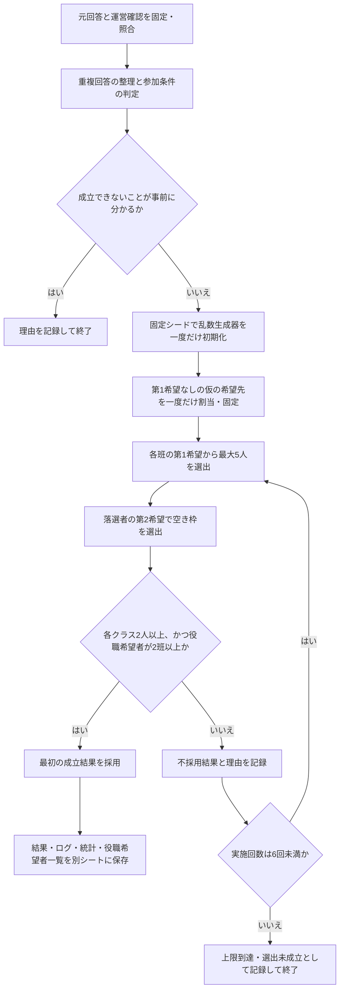

# 卒業を祝う会 実行委員の抽選方法

生徒の希望をできる限り尊重しながら、学年全体の運営と各クラスへの連絡体制を確保するための選出方法を説明する。公平性の根拠は、全員に共通するルールを抽選前に固定し、運営側の好みによる選び直しを防ぎ、過程を後から検証できることにある。

**実装：`apps-script/CommitteeLottery.js` に抽選処理を実装している。** 前半は抽選方法と公平性の説明、後半の「プログラムの使い方と実装解説」は操作手順・具体的な計算規則・保存形式を説明する。コードの実装、デプロイ成功、実際のシート上での実行確認は区別する。

## 抽選方法の概要

次の5つの委員（班）について、**各班5人、合計25人を定員**として選出する。第1希望・第2希望を考慮し、定員を超える希望者がいる場合はランダム抽選で選ぶ。希望者が定員に満たない場合は全員を選出し、希望に沿っても埋まらない枠は欠員とする。

| 委員（班） | 定員 |
| --- | ---: |
| 企画班 | 5人 |
| 司会進行班 | 5人 |
| 音響照明班 | 5人 |
| 会場演出班 | 5人 |
| 有志団体統括班 | 5人 |
| **合計** | **25人** |

乱数は、抽選前に固定したシード（乱数生成の出発点）から、**SHA-256ハッシュ連鎖**で順番に生成する。同じ入力・シード・プログラムの版で抽選過程を再現できるようにするためである。

候補者の選出には、長年使われている標準的なランダムシャッフルのアルゴリズムである **[Fisher–Yates シャッフル](https://ja.wikipedia.org/wiki/フィッシャー–イェーツのシャッフル)** を使用する。各段階で一様な乱数を使うことを前提に、候補者のすべての並び方を等しい確率で生成できる性質を持つ。本プログラムでは、乱数を整数へ変換する際の偏りも避ける処理を行い、並べ替えた候補者の先頭から必要な人数を選ぶ。

最終結果には、後述するクラスごとの最低人数などの採用条件も適用する。シャッフル方式の性質と、これらの条件を含む最終的な当選確率は区別して説明する。

## 募集人数と、20人から25人に増員した理由

対象は、企画班、司会進行班、音響照明班、会場演出班、有志団体統括班の5班。当初の各班4人・合計20人から、**各班最大5人・合計最大25人**へ増員する。

主な理由は、委員長・副委員長の業務負担を考慮するためである。委員長・副委員長も、当初割り当てられた班の仕事を兼務する。ただし、活動の軸足は実行委員会全体の運営に置くため、所属班の仕事に充てられる時間や労力が少なくなることを想定している。

そこで各班を1人ずつ増員し、役職に1人を送り出した場合でも、班の活動を中心的に担う4人を確保できる体制を目指す。委員長と副委員長は異なる班から選ぶ方針とする。

また、今年度は重複回答を整理した後の応募者が69人と、例年より多かった。増員には、運営体制を補強するとともに、できるだけ多くの生徒に役割を担ってもらい、当選の機会を広げる利点もある。69人は参加条件による除外前の人数である。

希望者が足りない班は欠員とするため、必ず25人を選出する方式ではない。「役職に1人を送り出しても4人を確保する」は、5人そろった班における定員設定の狙いであり、欠員のある班について4人を保証するものではない。

## 抽選対象者の確認

### 1人を複数の応募として扱わない

同じ「クラス＋出席番号」の回答は同一人物として照合し、**入力として固定した回答の行順で、最後に出てくる回答**を採用する。先に回答した人を抽選で優先することはなく、タイムスタンプの大小で採用する回答を選び直すこともしない。

出席番号の全角・半角、先頭のゼロ、末尾の「番」は、照合時に同一視する。この処理は読み取ったデータ上で行い、元の回答シートを修正・削除・並べ替えない。

### 運営側の確認は別シートで管理する

フォーム回答と、運営側が確認した事情を区別するため、後者は「運営確認」シートの表「運営追記」に記録する。**重複不可委員への就任状況は、この運営確認から照合する。**

運営確認は、採用した回答に結び付けるだけでなく、クラスと正規化した出席番号で本人に照合する。回答が重複していても、運営確認の記録が失われないようにする。

次の条件を、全員に共通して適用する。

| 判定項目 | 扱い |
| --- | --- |
| 「重複不可委員就任済み」に記載がある | 抽選対象から除外する |
| オリエンテーションへの参加について「参加できません」と回答 | その項目の公欠承認がなければ除外する |
| 準備・打ち合わせへの参加について「参加できません」と回答 | その項目の公欠承認がなければ除外する |
| 準備・打ち合わせへの参加について「予定によっては参加できない日があります」と回答 | この回答を理由に除外しない |
| 準備・打ち合わせへの参加について「参加が難しい可能性があります」と回答 | この回答を理由に除外しない |
| 運営確認で、その参加項目について公欠承認済み | 該当する参加条件を満たすものとして扱う |

準備・打ち合わせへの参加については、「参加できません」以外の回答を、その回答だけを理由に除外しない。

### 重複不可委員の範囲と、抽選対象から除く理由

重複不可委員とは、卒業を祝う会と同時期に活動する、**合唱コンクールに関する委員と、卒業アルバムに関する委員**を指す。これらの委員と卒業を祝う会の実行委員との兼務は、募集時に禁止と明記し、就任済みの生徒は本委員に応募しないよう案内している。

この条件には、次の3つの理由がある。

1. **なるべく多くの生徒が、卒業を象徴する行事の運営に関われるようにするため。** 卒業を祝う会、合唱コンクール、卒業アルバムという3つの取組を、できるだけ多くの生徒が役割を担って運営することを基本方針としている。
2. **同時期の大きな行事を兼務することによる、実務上の支障を避けるため。** 準備や打ち合わせの日程が重なり、ダブルブッキングなどが起きやすくなることを考慮している。
3. **募集条件を守って応募を控えた生徒との公平性を保つため。** 兼務禁止の案内に従い、本委員への応募を辞退した生徒もいると考えられる。応募後に兼務を例外的に認めて抽選対象に含めると、事前のルールを守った生徒との間で扱いに差が生じる。

そのため、該当する委員に就任済みの生徒は、事前に示した応募条件に基づいて抽選前に対象外とし、**抽選対象人数（母数）に含めない。** 「運営確認」シートの表「運営追記」に記録した就任状況を用いて、全員に同じ条件を適用する。

### 部活動による出演予定は抽選の当否に使わない

部活動への所属や、部活動で卒業を祝う会に出演する予定・可能性は、今回の抽選の当否に考慮しない。出演に関する回答を理由とする加点・減点・優先・除外は行わない。

多くの生徒が部活動に所属しており、出演の可能性がある生徒も広く存在する。また、現時点では出演の有無を確定できない。未確定の出演見込みによって応募者を不利に扱うことを避けるため、この情報を今回の選出条件には用いない。

募集時に兼務禁止を明記した合唱コンクール・卒業アルバムの委員への就任と、部活動での未確定の出演予定は、こうした事情の違いに基づいて扱いを分ける。出演と実行委員の活動との具体的な両立については、フォームの案内どおり別途確認する。

### 公欠承認の適用範囲

公欠承認は、オリエンテーションと準備・打ち合わせの参加条件ごとに適用する。オリエンテーションについて公欠が認められても、準備・打ち合わせに参加できず、その項目の公欠承認もなければ除外する。公欠承認によって、重複不可委員の除外を取り消すことはない。確認理由は「運営追記」のメモに残す。

## 希望に基づく選出の順序

### 第1希望による選出

まず、全班について第1希望の応募者から選出する。

- 対象者が5人以下の場合は全員を選出する。
- 対象者が5人を超える場合は、その班の応募者から抽選で5人を選出する。

第2希望の内容を理由として、第1希望の抽選で優先したり、不利に扱ったりしない。同じ班・同じ希望順位の抽選に、個人ごとの加点や優先順位を設けない。

### 第2希望による選出

全班の第1希望による選出が終わってから、**第1希望で落選した人だけ**を対象に、第2希望の班の空き枠で選出する。

- 希望者が空き枠以下の場合は全員を選出する。
- 希望者が空き枠を超える場合は、希望者から空き枠の人数を抽選する。
- 第1希望ですでに選ばれた人は、第2希望の抽選に参加しない。1人が複数の班に選ばれることはない。
- 第2希望が「特になし」の人を、別の班へ自動で回すことはしない。
- それでも埋まらない枠は欠員とする。第3希望の推測や、希望していない班への追加の割当は行わない。

### 「第1希望なし」の扱い

第1希望が「特に希望なし」の人には、選出に先立ち、5班から等しい確率で1班を仮の第1希望として割り当てる。その後は、その班を第1希望とした他の応募者と同じ手順で選出する。

この割当は固定シードを用いて**最初に一度だけ**行う。再抽選でも変更しない。仮の割当先と元の回答は区別して記録し、元の回答は書き換えない。

不足班への優先配置は行わない。「希望なし」と回答することで、必ず当選できる仕組みにはしないためである。ただし、班ごとの応募倍率が異なる以上、ランダムに割り当てられた班によって当選しやすさは変わる。「希望なし」と特定の班を希望した人の当選確率が、常に同じになるわけではない。

## 抽選結果の採用条件と再抽選

第1希望・第2希望による選出を終えた時点で、次の**両方**を確認する。

1. 各クラスから少なくとも2人が当選している。
2. 当選した委員長・副委員長希望者が、少なくとも2つの班に所属している。

各クラスの最低人数は、クラスへの連絡体制を確保するために設ける。一方、クラスごとに応募者数が異なるため、各クラスから一律に5人ずつ選ぶ方式は採用しない。

役職希望者の所属班に関する条件は、異なる班から委員長・副委員長を選ぶ話し合いができる状態を確保するために設ける。役職希望者が0人の場合、1人だけの場合、全員が同じ班の場合も条件未達となる。

条件未達の場合は、一部の当選者を手作業で入れ替えず、**第1希望・第2希望による委員選出全体**をやり直す。「第1希望なし」の仮の割当は維持する。2つの条件は、毎回、同じ当選結果に対して同時に確認する。

**両方の条件を初めて満たした結果を採用し、そこで抽選を終了する。** さらに好ましい結果を探して続けたり、複数の成立結果から運営側が選んだりはしない。

### 回数の上限と、成立しない場合

上限は、**初回1回＋再抽選最大5回、合計最大6回**とする。

- 候補者数や希望先などから、条件を満たせないことが事前に分かる場合は、開始せず理由を記録する。
- 事前確認を通過しても、条件を満たす結果が得られるとは限らない。
- 第6回までに条件を満たさなければ、当選結果を採用せず「試行回数の上限により選出未成立」として終了する。
- 上限到達は「その試行範囲では結果を得られなかった」ことであり、成立する組合せが存在しないことの証明とは区別する。
- 条件の自動緩和、試行回数の自動延長、結果を見てのシード変更は行わない。

## 委員長・副委員長の決め方

プログラムでは、委員長・副委員長を抽選で決定しない。

採用された当選者のうち、質問2で「希望する」と回答した人全員を、所属班付きの別シートに一覧化する。この一覧の中から、委員長と副委員長が異なる班となるよう、話し合いで決定する。

選出後も、両者は当初割り当てられた班を兼務する。役職決定を理由として、ほかの当選者を入れ替えたり、委員全体を選び直したりしない。

## 乱数・再現性と、恣意的な選び直しの防止

シードはプログラム外でランダムに作成し、抽選結果を見る前にコード内の定数として固定・記録する。抽選プログラムが実行時にシードを生成・自動更新することはない。

乱数生成器は、そのシードで最初に一度だけ初期化する。以後は、定めた計算規則と内部状態に従って、次の乱数を順に生成する。再抽選でも初期化し直さず、同じ乱数列を続けて使用する。実行時刻などを抽選判断に使わない。

同じ入力内容・入力順序、運営確認、シード、プログラムの版を使えば、仮の希望先、各試行の抽選過程、採用結果を再現できる方式とする。

再現できることに加え、ルール・入力・シードを実行前に固定し、採用・不採用の全試行を残すことで、都合のよい結果への選び直しがないかを検証できるようにする。

## 結果・ログ・統計の保存

元の回答シートと「運営確認」は抽選プログラムで変更せず、抽選開始時の入力として固定する。使用した内容を後から照合・再現できる記録を保管する。

日常の確認では最新結果を迷わず参照できるように、**最新の実行の結果・ログ・統計を1セットだけ残す。** 新しい出力と履歴の保存が完了してから、プログラムが作成した旧出力を整理する。元の回答シートと「運営確認」は変更・削除しない。

| 出力 | 記録する内容 |
| --- | --- |
| 抽選結果 | 当選者と所属班。選出未成立の場合は、成立した当選結果として扱わない |
| 詳細ログ | 入力の照合情報、除外・公欠の適用理由、仮の希望先、シード、プログラムの版、処理順、使用した乱数、全試行の結果・不採用理由・採用した試行番号 |
| 元データの統計 | 応募者数、重複回答数、除外理由別の人数、抽選対象者数、クラス・希望別の内訳 |
| 抽選結果の統計 | 班・クラス別の当選者数、欠員数、採用条件の確認結果 |
| 委員長・副委員長希望者一覧 | 採用された当選者のうち、役職を希望する人と所属班 |
| 入力控え | 使用した元回答と運営確認の読取値、元のシートと行を再現できる記録 |

最新実行の詳細ログには、不採用を含む全試行を残す。当選者の表には、そのうち採用された試行だけを表示する。シードや実行状態などの共通情報は「抽選_実行情報」にまとめる。実行日時は記録するが、抽選判断には使用しない。

過去の実行については、「抽選_実行履歴」に**日時・シード・コードの版・入力／結果／全試行ログのハッシュなどの再検証情報だけ**を追記する。過去の表や詳細ログの全文は残さない。元回答と運営確認が不変で、当時のコードとシードがあれば、過去の抽選を再実行し、その結果とログのハッシュを照合できる。

この前提を守るため、過去と入力のハッシュが異なる場合は旧出力の置換を停止する。入力を将来変更する際には、当時の入力を別途保管する方針が必要になる。ハッシュは内容の一致を確認する手段であり、それ自体から元の内容を復元したり、履歴が一度も書き換えられていないことを証明したりするものではない。

個人を識別する情報や生の回答は、README、Git、公開CIログには掲載しない。結果や詳細記録は、必要な閲覧範囲で確認できるように管理する。

## 公平性として考慮すること・しないこと

この方式は、**すべての応募者の最終的な当選確率を同じにするものではない。**

希望する班の倍率による差に加え、各クラスの最低人数と、役職希望者を複数班に確保する条件によっても、当選確率に差が生じ得る。役職希望の有無も、結果の採用条件を通じて委員への当選確率に影響する。

これらは、希望の尊重、連絡体制、役職を決められる運営体制という目的のための条件として、抽選前に明示する。

| 考慮すること | 当選の優先度に使わないこと |
| --- | --- |
| 参加条件、確認済みの重複不可委員への就任、公欠承認 | 条件に定めていない個人的な評価 |
| 第1希望・第2希望と、各班の定員 | 第2希望の書き方による、第1希望抽選での個別の優遇・不利益 |
| 各クラス最低2人の連絡体制 | 各クラスを一律に5人ずつとする人数調整 |
| 当選した役職希望者が2班以上にいること | 氏名・メールアドレス・出席番号の大小・回答の早さによる優先 |
| 全員共通の無作為な選出手順 | 運営側の望む人物や組合せに合わせた入替え |

公平性の説明と検証では、共通ルールの事前固定、例外の根拠、全試行の記録、再現性を確認する。再現性だけで、全員の当選確率が等しいことまで証明できるわけではない。

## 処理の流れ



再抽選の矢印は第1希望による選出へ戻る。シードの初期化や「第1希望なし」の割当へは戻らず、乱数生成器の状態も引き継ぐ。

## 入力データの構成

### Google Formsの回答シート

フォーム回答の現在の構成は次のとおり。抽選に使う元回答は変更しない。

| 列 | 内容 | 主な用途 |
| --- | --- | --- |
| A | タイムスタンプ | 回答の記録。当選の優先度には使わない |
| B | メールアドレス | 本人確認情報。当選の優先度には使わない |
| C | 名前 | 本人確認・結果表示。当選の優先度には使わない |
| D | クラス | 本人の照合、クラス別の最低人数確認 |
| E | 出席番号 | 正規化した上で本人を照合。番号の大小で優先しない |
| F | 質問2：委員長・副委員長の希望 | 結果の採用条件、当選後の希望者一覧 |
| G | 質問3：第1希望 | 第1希望による選出 |
| H | 質問4：第2希望 | 第1希望落選者の空き枠での選出 |
| I | 質問5：当日の出演予定・可能性 | 本方式の抽選で加点・減点・除外に使わない |
| J | 質問6：出演についての自由記述 | 本方式の抽選で加点・減点・除外に使わない |
| K | 質問1：オリエンテーション参加可否 | 公欠承認を含めた参加条件の確認 |
| L | 質問7：準備・打ち合わせの参加可否 | 公欠承認を含めた参加条件の確認 |
| M | 質問10：その他の自由記述 | 本方式の抽選で加点・減点・除外に使わない |

当日の出演と実行委員との兼任可否は、フォームの案内どおり、抽選の当選優先度とは別に確認する。

### 「運営確認」シートの表「運営追記」

| 項目 | 用途 |
| --- | --- |
| クラス | 本人照合のキー |
| 番号 | 正規化して本人照合のキーにする |
| 11月21日不参加特別理由 | オリエンテーションへの参加についての承認済み公欠を確認 |
| 打ち合わせ不参加特別理由 | 準備・打ち合わせへの参加についての承認済み公欠を確認 |
| 重複不可委員就任済み | 記載がある人を除外 |
| メモ | 本人確認や名簿確認などの根拠。当選の優先度には使わない |

## プログラムの使い方と実装解説

以下は、抽選方法をプログラムとしてどう実現しているかの説明である。コードの版と抽選手順の版を区別し、シードとともに出力へ記録する。

### 操作手順

1. テスト用スプレッドシートに、フォーム回答と「運営確認」シートの表「運営追記」を用意する。
2. コードの**先頭行**の `LOTTERY_SEED` を確認する。初期値にはプログラム外で一度生成した256ビット・64桁の16進数を設定済みである。実際の抽選に使用する入力・コードの版・シードを、結果を見る前に固定する。
3. シートを開き直し、メニュー「委員抽選」から「入力・成立条件を確認（書込なし）」を実行する。初回はGoogleの権限確認が必要になる。
4. 応募者数、除外人数、対象者数、事前に判明した成立不能の理由を確認する。この操作では抽選せず、乱数も消費せず、シートに書き込まない。
5. 「抽選を実行して最新結果を保存」を実行する。
6. 「抽選_実行情報」の状態と「抽選_実行履歴」の保存完了を確認する。**状態が「成立」で保存が完了した場合だけ、「抽選_結果」の当選者を採用する。** 成立時は「抽選_結果」「抽選_役職希望者」がシート一覧の先頭に並ぶ。
7. 過去実行を確認する場合は「実行履歴をハッシュ照合（書込なし）」を実行する。現在の入力と履歴のシードから再計算し、結果と全試行ログのハッシュを照合する。シートの追加・更新や新たな結果の採用は行わない。

Apps Scriptエディタから、次の関数を直接実行することもできる。

| 関数 | 動作 |
| --- | --- |
| `onOpen` | メニューを追加するだけ。抽選・入力変更・結果保存を行わない |
| `previewCommitteeLottery` | 入力検査と成立に必要な条件の確認。乱数を消費せず、書込なし |
| `myFunction` | 以前の入口名を残したもの。`previewCommitteeLottery` と同じ入力確認を行う |
| `runCommitteeLottery` | 抽選を実行し、最新の結果・ログ・統計を保存して、旧出力を整理する |
| `verifyLotteryHistory` | 保存が完了した過去実行を再現し、結果と全試行ログのハッシュを照合する。書込なし |

デプロイだけで抽選は実行されない。テスト用シートで動作確認した版を本番へ反映する手順は、[デプロイ手順](docs/apps-script-deploy.md)を参照する。本番シートで開発用の試行を行わない。

### 入力の読み取りと本人の照合

コードは `SpreadsheetApp.getActiveSpreadsheet()` で、実行中のスクリプトに紐づくファイルを使用する。本番ファイルのIDはコードに固定していない。マニフェストの権限は `spreadsheets.currentonly` とし、現在のファイル内で読み書きを行う。

回答の項目は、位置番号ではなく「名前」「クラス」「出席番号」と、各質問番号を含む見出しで特定する。見出しの改行・空白・全角半角の表記差は、照合時に正規化する。旧「重複立候補不可チェック」は、残っていても除外判定に使わない。

回答シートは先頭行の見出しから一意に検出する。「運営確認」と、プログラムが作成した `抽選_` で始まるシートは検出対象から除く。回答シートが複数ある場合は、冒頭の `LOTTERY_SETTINGS.responseSheetName` に対象のシート名を明示する。

「運営追記」は、**「運営確認」上で6つの項目名がそろう見出し行**を一意に探し、その下の行を読む。Google Sheetsのテーブル用APIには依存せず、テーブル名のメタデータ自体は照合していない。そのため、「運営確認」にはこの6項目の表を1つだけ置き、見出しより下に別の表や注記の行を混在させない。表の全項目が空の行は読み飛ばす。

本人のキーは、クラスと正規化した出席番号の組合せである。番号は全角を半角にそろえ、空白、末尾の「番」、先頭のゼロを照合上取り除き、正の整数として比較する。クラスはA組からE組を対象とする。

回答は元の行順で読み、同一キーの最後の行を採用してから、その回答内容を検査する。採用しない古い回答の希望内容は抽選に使わない。ただし、各行の本人を識別するため、クラスと出席番号は重複処理前に検査する。

「運営確認」は同じキーで独立して照合する。公欠承認は参加項目ごとに扱い、重複不可委員への就任があれば公欠の有無にかかわらず除外する。第2希望の空欄は、選択が任意であることから「希望なし」と同様に扱う。準備・打ち合わせについては「参加できません」以外を理由に除外しない。

見出しの不足・重複、本人キーの不正、未対応の希望役割、同一人物の運営確認の重複、応募者と対応しない運営確認、空欄・「公欠」以外の未定義の特別理由などは入力エラーとする。**入力エラーでは抽選も出力の追加も行わず停止し、運営側へ確認を求める。** プログラムが回答を推測して補正することはない。

### 処理順の固定

入力の重複処理を終えた後、候補者をクラスの順（A組、B組、C組、D組、E組）、次に出席番号の数値の昇順で並べる。この並べ替えは読み取ったコピー上だけで行う。

班の処理順は、企画班、司会進行班、音響照明班、会場演出班、有志団体統括班で固定する。全班の第1希望を処理した後、全班の第2希望を処理する。第2希望の候補者は、その時点でどの班にも選ばれていない人に限る。

氏名、メールアドレス、回答時刻、出演予定、自由記述は乱数の生成や候補者の優先度に使用しない。処理順の固定は再現性のためであり、番号の小さい人から定員を埋める方式ではない。

### SHA-256ハッシュ連鎖による乱数

シードは64桁の16進数を32バイトに変換したものを初期状態とする。次の状態は、直前の**32バイト全体**のSHA-256から生成する。

```text
H[0] = 16進数のLOTTERY_SEEDを32バイトに変換
H[n] = SHA-256(H[n-1])
u[n] = H[n]の先頭4バイトを、ビッグエンディアンの符号なし32ビット整数として読む
```

次の状態を作る際には、取り出した32ビット整数だけでなく、直前の256ビット状態全体を使う。`Math.random()` や時刻は抽選判断に使用しない。

0以上k未満の整数が必要なときは、単純な余り計算による偏りを避けるため、次の棄却法を使う。

```text
limit = floor(2^32 / k) × k
u < limit なら u mod k を採用
u >= limit なら、その値を記録して棄却し、連鎖の次の乱数で再試行
```

各生成について、乱数位置、使用目的、生成前後の状態、32ビット値、範囲k、棄却の有無、採用した整数をログに残す。数値の棄却は整数への変換処理であり、委員選出をやり直す「再抽選最大5回」とは別である。

抽選対象者のうち第1希望がない人を、固定した候補者順で一度だけ処理し、k=5の整数から仮の希望先を決める。その後、各試行で同じ乱数生成器を使い続ける。

### 候補者の抽選とFisher–Yatesシャッフル

班ごと・希望順位ごとの候補者が空き枠以下なら全員を選び、そのための乱数は消費しない。候補者が空き枠を超えるときだけ、候補者リストのコピーをFisher–Yates方式でシャッフルする。

リスト末尾の位置iから1まで、0以上i以下の整数jを上記の棄却法で生成し、位置iと位置jを交換する。全体をシャッフルした後、先頭から空き枠分の人数を選ぶ。候補者の元リストや元シートは変更しない。

各抽選枠の候補者、選ばれた人、選ばれなかった人、希望順位、使用した乱数を記録する。第1希望から落選した人だけが第2希望の空き枠に進み、同一人物の複数選出は防ぐ。

再抽選では、前回の当選者を保持せず、第1希望・第2希望による選出全体を作り直す。仮の第1希望と乱数生成器の状態は維持する。条件を初めて満たした試行で停止し、最大で試行1から試行6までを実行する。

### 成立に必要な条件の事前確認

抽選対象者について、各クラスが2人以上、役職希望者が2人以上、その希望先が合計2班以上あることを確認する。

加えて、希望順位を一時的に緩和した次の最大流問題で、クラスごとの最低人数を班の定員内に配置することすら不可能でないかを確認する。

- 各クラスから2人分の流れを取り出す。
- 1人を複数回数えないよう、各候補者の容量を1とする。
- 候補者は第1希望・第2希望の班へ進める。第1希望なしの候補者には、この事前確認に限り5班すべてを可能性として与える。
- 各班の容量を5とし、合計10人分の流れが作れるかを調べる。

この緩和条件でも配置できなければ、実際の方式でも成立しないため停止できる。一方、配置できても、第1希望の優先、仮の希望先の割当、役職希望者の実際の当選を保証するものではない。**事前確認は必要条件の検査であり、実際の当選者を最適化して決める処理や、成立可能性の完全な証明ではない。**

入力が正しく、事前条件だけが不成立の場合は、試行数0・乱数消費0として理由・統計・入力控えを保存する。

### ファイル構成と内部処理

| 主な処理 | 役割 |
| --- | --- |
| `readInputSheets_` | 回答シートの検出、運営確認の見出し検出、読取値と範囲の固定 |
| `prepareLotteryInput_` | 本人照合、最後の回答の採用、運営確認の適用、対象者の確定 |
| `checkPossible_` | 人数・役職希望先・最大流による事前の必要条件確認 |
| `createRandom_` | SHA-256連鎖と、棄却法による整数生成 |
| `runLotteryEngine_` | 仮の希望先、最大6試行、採用条件の確認。シートの書込を行わない |
| `buildOutputPlans_` | 結果・ログ・統計・入力控えの表データをメモリ上で作成 |
| `makeRunRecord_` | 入力・結果・全試行ログのハッシュと、版・シード等の再検証情報を作成 |
| `writeOutputPlans_` | 新出力の保存、履歴への追記、固定名への切替、管理対象の旧出力の整理 |
| `verifyHistoryEntries_` | 現在の入力から過去実行を再計算し、保存済みハッシュと比較 |

`apps-script/CommitteeLottery.js` に実行用コードをまとめ、Node.jsのテストからは末尾の条件付きエクスポートで抽選本体を読み込む。Apps Script上では `module` が存在しないため、このテスト用エクスポートは実行されない。

コード版は `LOTTERY_VERSION = '1.1.0'`、抽選手順の版は `LOTTERY_ALGORITHM_VERSION = '1.0.0'` として区別する。今回の保存・表示の変更で、候補者の選出手順と乱数列は変えていない。GitHub Actionsはデプロイ対象コミットのSHAを `apps-script/BuildInfo.js` に生成して一緒に送信し、履歴にも記録する。生成ファイルはGit管理外である。この定数がない手動反映では `manual-build` と記録するため、当時のコードを別途保管する必要がある。

### 出力シートと入力の再現記録

最新実行の出力は、次の固定名の7シートにまとめる。履歴は別の1シートに追記する。

| シート名 | 内容 |
| --- | --- |
| `抽選_結果` | 採用された当選者と班・当選段階・元回答行・役職希望 |
| `抽選_役職希望者` | 採用された当選者のうち役職を希望する全員。役職そのものは決定しない |
| `抽選_実行情報` | 実行ID、状態、版、Gitリビジョン、シード、入力範囲、各ハッシュ等の共通情報 |
| `抽選_詳細ログ` | 重複処理、参加条件、仮の希望先、乱数、全試行の判断過程 |
| `抽選_元データ統計` | 元回答件数、応募者数、除外人数、対象者数、クラス・希望別の内訳 |
| `抽選_結果統計` | 各試行の班・クラス別人数、欠員、役職希望者数・所属班数、不採用理由 |
| `抽選_入力控え` | 使用した回答・運営確認の全読取値を、元シート・元行番号付きの型付きJSONとして保存 |
| `抽選_実行履歴` | 過去と今回の日時・シード・コード版・各ハッシュ等を追記。表やログの全文は保存しない |

結果と役職希望者は**1行目が見出しの表だけ**とし、上部に実行情報を繰り返し表示しない。先頭行を固定し、列幅と見出しの色を整え、データがある場合はフィルターを付ける。成立時は結果・役職希望者・実行情報の順で先頭に並べる。

入力の各セルを型と値の組にし、日付はUTCのISO文字列として記録する。1行の型付きJSON文字列の配列を再びJSON化し、そのUTF-8バイト列のSHA-256を入力照合用のハッシュとする。元回答と運営確認は、それぞれ別にハッシュを記録する。

結果ハッシュは、成立状態・採用試行番号と、班順・クラス順・番号順にそろえた当選者および役職希望者の本人キー・所属班・選出段階を、固定形式のJSONとしてSHA-256へ渡す。ログハッシュは、全試行を含む判定ログ配列のJSONから計算する。表示上の列幅・シート位置や実行日時は、これらのハッシュに含めない。

実行IDには時刻とUUIDを使うが、いずれも抽選判断には使わない。既存IDと衝突した場合は枝番で区別する。同じ入力・シードで再実行した場合、抽選過程とハッシュは再現され、実行IDや日時は別になる。各出力のA1セルのメモに、管理用識別子・実行ID・再検証情報・保存状態を記録し、表の値とは分けて関連付ける。このメモを手動で書き換えない。実行中の同時起動はドキュメントロックで拒否する。

履歴の「再検証情報（JSON）」には、シード、コード・アルゴリズムの版、Gitリビジョン、元回答と運営確認のハッシュなどを格納する。保存準備・保存完了・保存失敗は別行で追記し、過去行は更新しない。照合対象は保存完了した実行と旧版移行済みの実行で、保存失敗が記録された実行は除く。同じ抽選アルゴリズムの版は現在のコードで照合し、異なる版は履歴のGitリビジョンから当時のコードを用意して確認する。

旧1.0.0形式の出力は、同一実行の共通情報と6種類の表がそろう一式だけを識別し、結果とログのハッシュを計算して「旧版移行」として履歴へ記録してから整理する。旧版は正確なコミットSHAを記録していなかったため、方式の版と既知の実装コミットへの参照を残す。不完全な旧出力や管理対象と確認できないシートは、警告して保持する。

判定ログの主な種別は次のとおり。

| 種別 | 内容 |
| --- | --- |
| `DUPLICATE_REPLACED` | 採用しなかった回答行と、後の採用回答行 |
| `ELIGIBILITY` | 本人キー、元回答行、運営確認行、参加条件、除外理由、公欠の適用 |
| `PRECHECK` | 事前確認の人数・配置可能人数・停止理由 |
| `FIXED_FIRST_PREFERENCE` | 第1希望なしの人に一度だけ与えた仮の希望先 |
| `RANDOM` | 乱数の状態・値・用途・棄却の記録 |
| `POOL`／`DECISION` | 抽選枠の候補者と各人の選出・落選 |
| `TRIAL_CANDIDATE_STATUS` | 各試行の全対象者について、選出段階、希望なし・空き枠なし・第2希望抽選落選などの理由、その試行自体の採否 |
| `ATTEMPT_START`／`ATTEMPT_END` | 試行境界、乱数位置・状態、採用条件の判定 |
| `FINISHED` | 成立、事前停止、または試行上限到達の終了状態 |

除外理由の `OTHER_COMMITTEE` は重複不可委員就任、`ORIENTATION_UNAVAILABLE` はオリエンテーション参加不可、`MEETINGS_UNAVAILABLE` は準備・打ち合わせ参加不可を示す。`ORIENTATION_EXCUSED` と `MEETINGS_EXCUSED` は、それぞれの公欠が実際に参加条件へ適用された記録である。同一人物に複数の除外理由がある場合、理由別人数の合計と除外者の実人数は一致しないことがある。

### 不成立・保存失敗の扱い

成立しなかった場合、各試行の仮の当選者はログ・統計へ残すが、**「結果」と「役職希望者」の当選者欄は空にする。** 最後の不採用結果を、そのまま当選結果として出力しない。

最新実行が不成立であれば、以前の成立結果を最新結果として残さず、空の結果表と今回の情報に置き換える。この場合は「抽選_実行情報」を先頭に置き、不成立の理由を確認できるようにする。

保存は次の順で行う。

1. 元回答・運営確認のハッシュを過去と照合する。入力変更や管理外シートとの固定名の衝突は、置換前に停止する。
2. 一時名の非表示シート7枚に新しい内容を書き込み、反映を確認する。
3. 未記録の旧出力の再検証情報と、今回の保存準備を履歴に追記し、反映を確認する。
4. 旧出力を一時名へ退避し、新出力を固定名へ切り替える。実行情報と管理メモの保存状態を確定して表示する。
5. 保存完了を履歴に追記して反映した後、識別済みの旧出力だけを削除する。

Google Sheetsへの複数シートの書込は一括の原子的な処理ではない。保存・切替に失敗した場合は、旧出力を削除せず、可能な範囲で名前を戻し、新出力を「出力失敗・当選未確定」として保持する。旧出力の削除だけが失敗した場合も保持して警告するため、例外的に複数セットが残ることがある。次の正常な実行で、管理対象を再び整理する。シート名の接頭辞だけで削除せず、元回答・運営確認・無関係なシートは削除しない。

**「保存中」「出力失敗」の出力は当選結果として使わず、最新7シートがそろい、実行情報と履歴で保存完了を確認する。** ハードタイムアウト等で保存が途中終了した場合も同様に扱う。

入力由来の文字列が数式として実行されないよう、出力時に先頭の数式記号を文字列としてエスケープする。入力控えの型付きJSONには元の値を保存する。書込先は新規作成した出力シートと管理用の実行履歴に限定する。

### ローカル検証とCI

Node.js 24で、外部パッケージを追加せずに実行できる。

```sh
node --check apps-script/CommitteeLottery.js
node --test tests/committee-lottery.test.cjs
```

テストは架空データだけをリポジトリに置き、SHA-256と整数変換、同一シードの再現性、入力の不変性、重複回答と運営確認、公欠の適用、第1・第2希望の順序、欠員、最大6回、再抽選時の乱数の継続、最初の成立結果での停止、結果未採用を検証する。さらに、旧1.0.0と同じ抽選ログが得られること、固定名と表の配置、旧出力の移行・整理、追記履歴からの再検証、入力変更時の停止、保存・名前切替・最終反映の失敗時の旧出力保持も確認する。シートの代替オブジェクトは、入力シートへの書込や削除を例外にして検出する。

GitHub Actionsも、構文検査とこのテストを通過してから `clasp push` を行う。デプロイ成功は、Google上の実際の読取・出力まで確認したことを意味しないため、初回はテスト用シートで入力確認と実行・出力確認を行う。

以下の初回統計は応募時点の固定記録であり、参加条件による除外後の人数や、抽選実行時の統計とは区別する。

## 元データの初回統計

2026年11月8日に提供された、第2希望までを含む表74回答と追加の1回答、計75回答を集計した。

同じ「クラス＋出席番号」の回答は、ユーザーの指定に従い、提供された表で最後に出てくる行を採用した。重複に当たる6回答を集計対象から除き、立候補者は **69人**。元データの修正・削除は行っていない。

出席番号は、集計上の同一人物の照合に限り、全角・半角、先頭のゼロ、末尾の「番」の表記差を同一視した。「最後」は提供された行順を指し、タイムスタンプによる判定ではない。

### クラス別立候補者数

| クラス | 立候補者数 |
| --- | ---: |
| A組 | 15人 |
| B組 | 17人 |
| C組 | 11人 |
| D組 | 12人 |
| E組 | 14人 |
| **合計** | **69人** |

### 実行委員長・副委員長の希望

質問2の回答を集計した。委員長・副委員長を個別に区分する回答ではないため、両者を合わせた希望者数を示す。

| 希望 | 人数 |
| --- | ---: |
| 希望する | 13人 |
| 希望しない | 56人 |
| **合計** | **69人** |

### 希望役割別立候補者数

第1希望・第2希望は、それぞれ独立に集計した。質問2で委員長・副委員長を希望している人も含む。

| 希望役割 | 第1希望 | 第2希望 |
| --- | ---: | ---: |
| 企画班 | 24人 | 23人 |
| 司会進行班 | 32人 | 6人 |
| 音響照明班 | 3人 | 6人 |
| 会場演出班 | 4人 | 28人 |
| 有志団体統括班 | 5人 | 2人 |
| 希望なし | 1人 | 4人 |
| **合計** | **69人** | **69人** |

「希望なし」は、第1希望の「特に希望なし」と第2希望の「特になし」を、表の表示上まとめたもの。

### 集計上の確認事項

- 重複回答がある人は6人。そのうち2人は希望内容が異なっていたため、指定どおり提供順で最後の回答を採用した。
- 第1希望と第2希望が同じ回答が1人分ある。回答内容は変更せず、それぞれの希望として集計した。
- クラス別、質問2、第1希望、第2希望の各合計が、すべて69人で一致することを確認した。

これは固定された元データの初回統計であり、ユーザーから更新の指示がない限り、再集計・変更しない。
